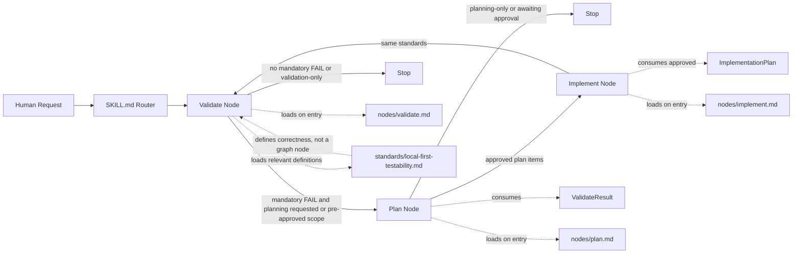
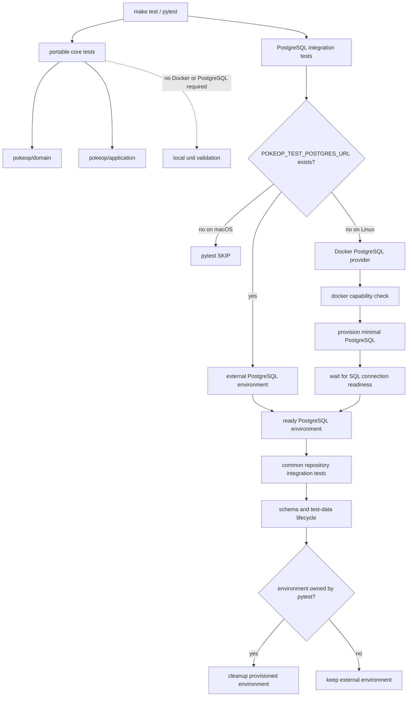

# PokemonBattleInference Testability Graph Router

Use this skill for Local-first Testability Graph work in the current PokemonBattleInference repository.

This file is only the graph router. Do not duplicate node execution rules or full standards here. Load the referenced node or standard file only when the graph edge requires it.

## Scope

The graph governs repository-level testability rules:

- Canonical local test entry.
- macOS/Linux shared test collection.
- Local-first unit tests for core and portable logic.
- Integration Environment Contract behavior.
- Separation of integration environment lifecycle from test assertions.
- Coverage policy placement.

For ordinary PokemonBattleInference business implementation work, rebuild context from repository files and apply local code/test conventions directly from the relevant source and tests. Do not use this graph as permission to refactor business code.

## Graph Topology

```text
Validate -> Plan -> Implement -> Validate
```

Repair is an edge decision, not a node. A gap analysis or standards audit stops after `Validate` unless the Human explicitly requests planning or grants a repair scope.

## Graph Architecture Overview

Mermaid diagrams are derived architecture views for Human/AI navigation. Router, Node, Standard and repository implementation definitions remain authoritative if a diagram becomes stale or conflicts with them.

### Graph Topology & Progressive Loading



### Local-first Testability Runtime Architecture



## Progressive Loading

- Initial load: read only this `SKILL.md`.
- Enter `Validate`: load `nodes/validate.md`; load `standards/local-first-testability.md` only when validating Local-first Testability standards.
- Enter `Plan`: load `nodes/plan.md`; consume the latest `ValidateResult` and any repair scope; do not reload unrelated nodes.
- Enter `Implement`: load `nodes/implement.md`; consume the approved repair scope and the matching plan items; do not copy validator logic.
- Re-enter `Validate` after implementation: load the same `nodes/validate.md` and the same relevant standards used by the first validation.
- Do not preload `Plan`, `Implement`, or extra standards because they might be useful later.

## Edges

`Start -> Validate`:

- Enter when the Human asks for audit, gap analysis, current-state validation, or testability rule compliance.
- Enter when implementation has just finished and the graph requires re-validation.

`Validate -> Stop`:

- Stop when all mandatory standards pass.
- Stop when the Human requested only validation or gap analysis.
- Stop when validation is blocked by missing repository evidence and no safe read-only path remains.

`Validate -> Plan`:

- Enter when `ValidateResult` contains mandatory `FAIL` items and the Human asks for a repair plan.
- Enter when `ValidateResult` contains failures covered by a pre-approved repair scope.

`Plan -> Stop`:

- Stop after producing a plan in validation-only, planning-only, or interactive-approval mode until the Human approves implementation.
- Stop when no plan item matches the approved repair scope.

`Plan -> Implement`:

- Enter with Human approval after the plan is produced.
- Enter without another approval prompt when the task began with a pre-approved repair scope and the plan items are within that scope.
- Never enter for optional improvements unless the Human explicitly included them in the repair scope.

`Implement -> Validate`:

- Always enter after approved implementation finishes.
- Use the same validation rules as the initial `Validate`.

## Termination Conditions

The graph terminates when:

- `Validate` reports no mandatory failures.
- The requested mode is validation-only or planning-only.
- The Human withholds approval for the next edge in interactive-approval mode.
- The pre-approved repair scope does not cover any current `ValidateResult` failure or resulting plan item.
- The graph is blocked by missing information that cannot be recovered through read-only repository inspection.

## Repair Scopes

Default mode:

- Validation-only requests stop after `Validate`.
- Planning-only requests stop after `Plan`.
- Interactive repair requests require Human approval after `Plan` and before `Implement`.

Pre-approved repair mode:

- The Human may authorize repair at task start, for example: "run the full repair loop and fix all mandatory failures found by this Validate."
- That authorization is a pre-approved repair scope.
- The scope may cover all mandatory failures or only specific standards, files, or problem classes.
- Only failures actually found by the current `Validate` and inside the scope are approved for planning and implementation.
- Optional improvements are excluded unless the scope explicitly includes them.
- `Plan` still must run and produce plan items before `Implement`.
- `Implement` may execute only plan items that match the approved scope.

## Global Invariants

- Preserve unrelated working-tree changes.
- Do not modify business code, tests, CI, or build logic during `Validate` or `Plan`.
- During `Implement`, modify only files approved by the plan.
- Do not redefine standards inside node files or final reports.
- Do not introduce new graph nodes for edge decisions.
- Do not split platform, Docker, or coverage standards into extra files unless the content grows into an independently maintained standard.
- Do not expose secrets, `.env` content, tokens, private keys, or database passwords in reports.
- Terminal output must be concise and evidence-grounded; avoid empty template sections and repeated boilerplate.
